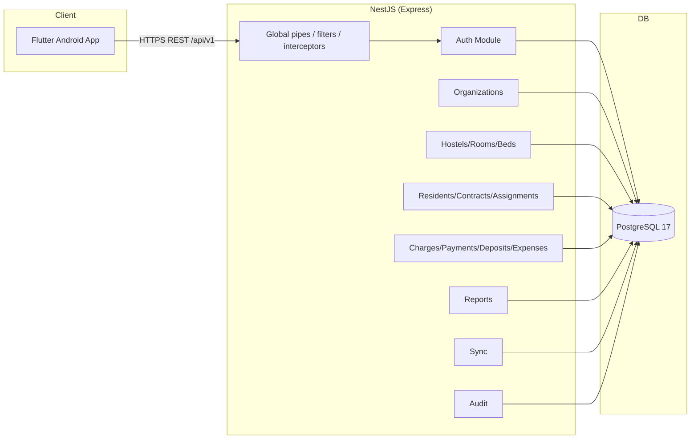
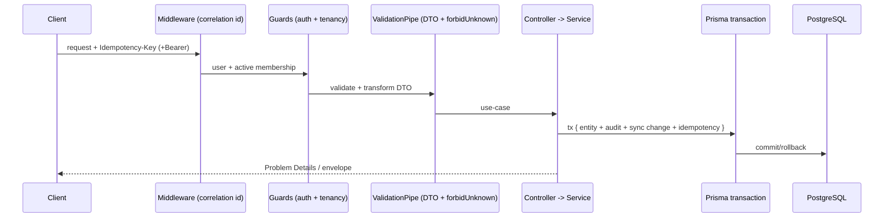

# نمای کلی معماری — ESKAN Backend

## نوع معماری

Modular Monolith (NestJS) + Prisma + PostgreSQL. نه microservices.

## نمای runtime

## ماژول‌ها و مرزها

هر feature ماژول NestJS مستقل با ساختار `api`/`application`/`domain`/`infrastructure` است.

| ماژول | مسئولیت |
|-------|---------|
| `auth` | ثبت/ورود/refresh/logout، JWT access، refresh rotation، hashing |
| `organizations` | پروفایل سازمان و عضویت‌ها/نقش‌ها |
| `hostels`/`rooms`/`beds` | master data لیلیه و archive/deactivate |
| `residents` | ساکنان و جست‌وجو |
| `stay-contracts` | قرارداد اقامت و state machine |
| `assignments` | تخصیص بستر و جلوگیری از overlap |
| `charges`/`payments`/`deposits`/`expenses` | هستهٔ مالی با reversal |
| `reports` | گزارش‌های پایه |
| `audit` | ثبت audit برای عملیات حساس |
| `sync` | تغییرات pull بر اساس cursor |
| `common` | config/errors/filters/validation/tenancy/logging/security |

## جریان درخواست (request pipeline)

## اصول

- tenant scope از security context؛ نه از body.
- تراکنش‌ها در serviceها (Prisma `$transaction`).
- پول از decimal.js و NUMERIC؛ هرگز Number.
- خطاها Problem Details با `code` پایدار و `traceId`.