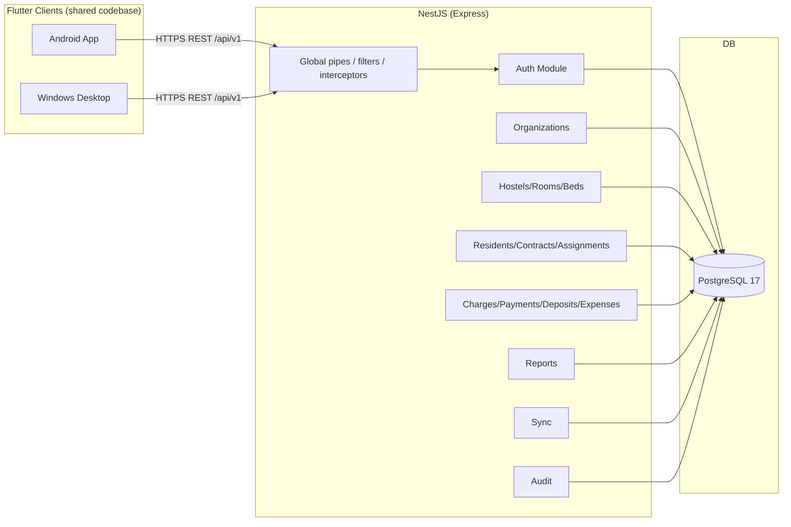
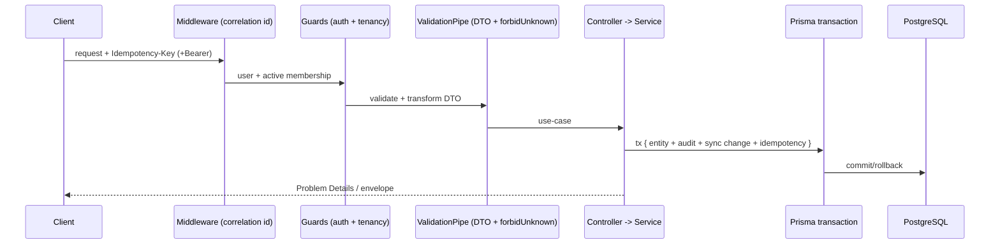

# نمای کلی معماری — ESKAN Backend

## نوع معماری

Modular Monolith (NestJS) + Prisma + PostgreSQL. نه microservices.

## پلتفرم‌های هدف کلاینت

- پلتفرم‌های هدف اولیهٔ کلاینت ESKAN: **Android** و **Windows Desktop** (هر دو با Flutter/Dart).
- هر دو کلاینت از Backend مشترک NestJS + PostgreSQL و API مشترک (`/api/v1`) استفاده می‌کنند.
- تا حد امکان از یک **codebase مشترک Flutter** استفاده می‌شود؛ منطق کسب‌وکار، مدل‌ها،
  API client و منطق sync مشترک‌اند و فقط لایهٔ UI/UX به‌تناسب فرم‌فاکتور تنظیم می‌شود.
- UI متناسب با موبایل (لیست/فرم لمسی) و دسکتاپ (صفحه‌کلید، جدول، جست‌وجو، گزارش، چاپ رسید) طراحی می‌شود.
- ذخیره‌سازی آفلاین با **SQLite/Drift** و sync با Backend؛ سازگاری کتابخانه‌ها با هر دو
  پلتفرم هنگام آغاز توسعهٔ کلاینت بررسی و آزموده می‌شود.
- **iOS / macOS / Web** در حال حاضر جزو اهداف اولیه نیستند؛ ارزیابی در مراحل بعد.

## نمای runtime

## ماژول‌ها و مرزها

هر feature ماژول NestJS مستقل با ساختار `api`/`application`/`domain`/`infrastructure` است.

| ماژول | مسئولیت |
|-------|---------|
| `auth` | ثبت/ورود/refresh/logout، JWT access، refresh rotation، hashing |
| `organizations` | پروفایل سازمان و عضویت‌ها/نقش‌ها |
| `hostels`/`rooms`/`beds` | master data لیلیه و archive/deactivate |
| `residents` | ساکنان و جست‌وجو |
| `stay-contracts` | قرارداد اقامت و state machine |
| `assignments` | تخصیص بستر و جلوگیری از overlap |
| `charges` | هستهٔ مالی M3a (Charge، BillingRun، AbsenceCredit) — پیاده‌شده |
| `payments`/`deposits`/`expenses` | مالی M3b/M3c — فقط در قرارداد/Schema؛ ماژول اجرایی هنوز ساخته نشده |
| `reports` | گزارش‌های پایه |
| `audit` | ثبت audit برای عملیات حساس |
| `sync` | تغییرات pull بر اساس cursor |
| `common` | config/errors/filters/validation/tenancy/logging/security |

> **وضعیت اجرای ماژول‌ها (2026-11-10):** پیاده‌شده: `auth`، `organizations`، `hostels`/`rooms`/`beds`،
> `residents`، `contracts`، `assignments`، `packages`، `charges` (M3a). مالی بعدی
> (`payments`/`deposits`/`expenses`)، `reports`، `sync` و `audit` فعلاً در قرارداد/Schema تعریف شده‌اند
> ولی ماژول اجرایی ندارند.

## جریان درخواست (request pipeline)

## اصول

- tenant scope از security context؛ نه از body.
- تراکنش‌ها در serviceها (Prisma `$transaction`).
- پول عدد صحیح AFN (A-016)؛ گردکردن proration با decimal.js؛ هرگز Number/Float/Double.
- خطاها Problem Details با `code` پایدار و `traceId`.