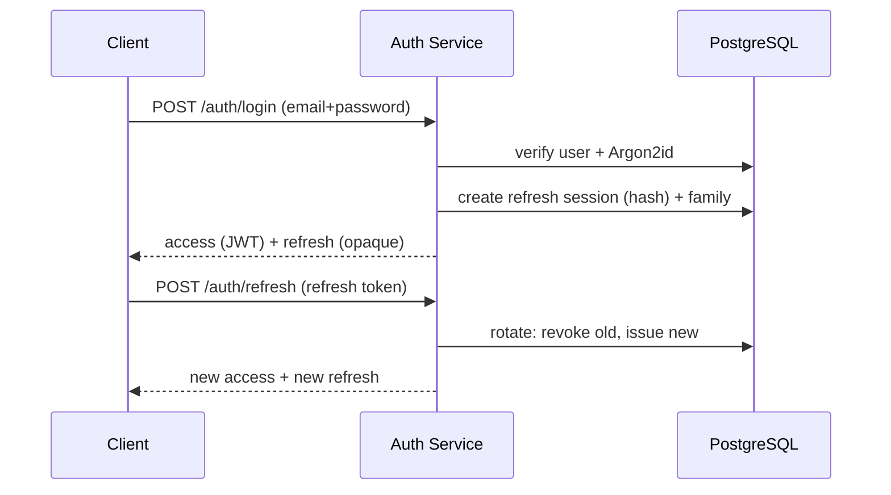

# جریان داده — ESKAN Backend

## 1. جریان احراز هویت و نشست



## 2. جریان مالی (payment و allocation جدا)

```mermaid
sequenceDiagram
  participant C as Client
  participant P as Payments Service
  participant D as PostgreSQL
  C->>P: POST /payments {amount, method, Idempotency-Key}  (unapplied)
  P->>D: begin tx; lock (organization→resident→payment); insert payment (unapplied)
  P->>D: صدور Receipt رسمی + sync change + audit
  P->>D: commit
  P-->>C: payment (unapplied) + receipt رسمی
  C->>P: POST /payments/{id}/allocations {chargeId, amount}
  P-->>C: allocation (append-only)
```

Payment ابتدا **unapplied** است؛ Allocation و Release عملیات مستقل و صریح‌اند (D-02).
مانده هر ساکن = Σ charges − Σ allocations (معتبر) − تعدیلات رسمی.

## 3. جریان همگام‌سازی (pull)

```mermaid
sequenceDiagram
  participant C as Mobile (offline-first)
  participant S as Sync Service
  participant D as PostgreSQL
  C->>S: GET /sync/changes?afterSequence=N&limit=100
  S->>D: select sync_changes where seq > N order by seq
  S-->>C: {changes[], nextCursor, hasMore}
  C->>C: persist atomically in SQLite; advance cursor
```

تغییر هر entity (UPSERT/TOMBSTONE) در همان transaction نوشتن entity ثبت می‌شود.

## 4. جریان tenant scoping

هر request سازمان فعال را از membership معتبر می‌گیرد؛ همهٔ queryها با
`organization_id` از context فیلتر می‌شوند (نه از body).